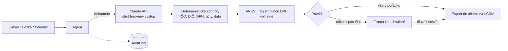

# Legent AI – sada agentů (v0.1)

Funkční základ AI agentů pro malé a střední firmy, na kterém Legent AI staví pilotní nasazení.
Tři agenti, jedna architektura: **AI čte, pravidla kontrolují, člověk schvaluje.**

| Agent | Vstup | Výstup | Kdy rozhoduje člověk |
|---|---|---|---|
| **Přijaté faktury** (`invoice`) | PDF, fotka nebo text faktury | strukturovaná data, kontroly, export k zaúčtování | nový dodavatel, chyba v kontrolách, částka nad limitem, nespolehlivý plátce DPH, nezveřejněný účet nad 540 000 Kč |
| **Poptávky** (`enquiry`) | e-mail / text z webového formuláře | kategorie, naléhavost, kontakt, návrh odpovědi s termíny | vždy – odpověď se nikdy neodešle sama (spam se jen archivuje) |
| **Týdenní KPI report** (`report`) | CSV vydaných faktur | KPI + krátký komentář | – (komentář smí obsahovat jen čísla z dat, jinak se použije šablona) |

Celý koncept produktu (katalog agentů, úrovně autonomie, bezpečnost, obchodní model, roadmapa):
[`docs/KONCEPT.md`](docs/KONCEPT.md).

## Rychlý start (bez API klíče)

```bash
cd legent-agents
npm install
npm test                          # 23 testů: validace, agenti, LLM vrstva, konektory
node bin/legent.js demo --offline # celá pipeline na smyšlených vzorových datech
```

Offline režim nahrazuje AI jednoduchými pravidly pro **vzorové** soubory ze `samples/` – slouží
k testům a ukázce celého procesu (kontroly, fronta, schválení, export, audit), ne k ostrému provozu.

## Ostrý provoz s Claude API

```bash
export ANTHROPIC_API_KEY=...      # nebo `ant auth login`
node bin/legent.js invoice faktura.pdf
node bin/legent.js enquiry poptavka.txt --profile firma.json --slots volne-terminy.json
node bin/legent.js report faktury-vydane.csv --as-of 2026-11-15
node bin/legent.js queue                     # co čeká na schválení
node bin/legent.js approve <id> --by "Jana"  # schválit (faktura se exportuje)
node bin/legent.js reject <id> --note "duplicita"
```

| Proměnná | Výchozí | Význam |
|---|---|---|
| `LEGENT_MODEL` | `claude-opus-5-5` | Model Claude. Levnější varianty (např. `claude-sonnet-5-5`, `claude-haiku-5-5`) zvažte až po změření kvality na vlastních dokladech. |
| `LEGENT_EFFORT` | `medium` | Hloubka uvažování (`low`…`max`). Poptávky běží na `low`. |
| `LEGENT_FALLBACKS` | zapnuto | Server-side fallback: když model požadavek odmítne, API ho zopakuje na záložním modelu. Vypnutí: `off`. |
| `LEGENT_ONLINE` | vypnuto | `1` = ověřování v ARES a v registru plátců DPH (MF ČR). |
| `LEGENT_AUTO_APPROVE_MAX` | `50000` | Nad tuto částku (Kč s DPH) jde faktura vždy člověku. |
| `LEGENT_REVIEW_NEW_SUPPLIERS` | zapnuto | První faktura nového dodavatele jde ke schválení. |
| `LEGENT_DATA` | `./data` | Fronta (`queue.jsonl`), audit log (`audit.jsonl`), exporty (`export-*.jsonl`). |

## Architektura



Klíčová rozhodnutí:

- **Workflow, ne volný agent.** Pořadí kroků řídí kód; model dělá to, co umí nejlépe – čte nestrukturované
  dokumenty a píše texty. Výsledek je předvídatelný, testovatelný a levnější.
- **Strukturované výstupy** (`client.beta.messages.parse` + Zod schéma) – odpověď modelu vždy odpovídá schématu.
- **Kontroly bez AI** – kontrolní součty IČO a účtů, sazby DPH 0/12/21 %, součty, data, duplicity.
- **Člověk ve smyčce** – vše sporné jde do fronty; schválení i zamítnutí se zapisuje do audit logu.
- **Ochrana proti prompt injection** – text dokumentů je pro model data, ne pokyny.
- **Logy bez obsahu** – audit log ukládá otisk dokumentu, ne jeho text; osobní údaje se maskují.
- **Report bez vymyšlených čísel** – čísla počítá kód; pokud komentář modelu obsahuje číslo mimo data, použije se šablona.

## Struktura

```
bin/legent.js          CLI (invoice, enquiry, report, queue, approve, reject, demo)
src/config.js          konfigurace z proměnných prostředí
src/llm.js             Claude API (strukturované výstupy, fallback) + offline režim
src/core/store.js      fronta ke schválení, audit log, exporty (JSONL), maskování údajů
src/validators/cz.js   IČO, DIČ, české účty, IBAN, sazby DPH
src/connectors/        ARES (REST), registr plátců DPH (SOAP MF ČR)
src/agents/            invoice.js, enquiry.js, report.js
samples/               smyšlená vzorová data
test/                  testy (node --test), testovací odpovědi ARES a registru DPH
docs/KONCEPT.md        produktový koncept Legent AI
```

## Známá omezení (v0.1)

- Parser odpovědi registru plátců DPH je ověřen na vzorové odpovědi; před ostrým nasazením otestujte proti živé službě MF ČR.
- Úložiště je souborové (JSONL) – pro pilota stačí, pro více klientů nahraďte databází se stejným rozhraním.
- Export je obecný JSONL; import do konkrétního účetního systému (Pohoda, Money S3, ABRA…) je další krok.
- Před nasazením u klienta vždy připravte sadu 30–50 jeho skutečných dokladů a změřte přesnost (viz koncept, kap. Měření).

## Samostatný repozitář

Sada je zatím součástí repozitáře webů. Do vlastního repozitáře ji lze přenést i s historií:

```bash
git subtree split --prefix=legent-agents -b legent-agents-only
git push git@github.com:<organizace>/legent-agents.git legent-agents-only:main
```
