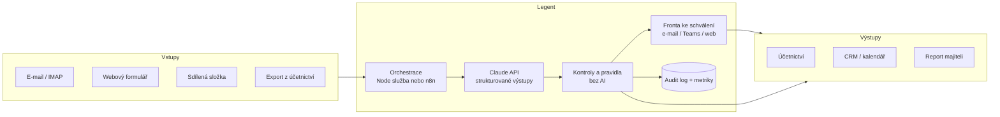

# Legent AI – produktový koncept

*Verze 0.1 · 20. 11. 2026 · interní pracovní dokument (Legacy Enterprises)*

## 1. Shrnutí

Legent AI nasazuje **AI agenty do provozu malých a středních firem** — tam, kde lidé opakovaně čtou,
přepisují, třídí a odpovídají. Nejde o chatbota ani o „AI strategii“, ale o konkrétní agenty, kteří
převezmou měřitelnou část rutinní práce a sporné případy předají člověku.

Princip, který odlišuje Legent od „AI hype“: **AI čte, pravidla kontrolují, člověk schvaluje.**
Každý agent má jasný vstup, výstup, kontroly, úroveň autonomie a metriku přínosu.

Výchozí stav: hotová sada tří agentů (`legent-agents/`, v0.1) — přijaté faktury, poptávky, týdenní
KPI report — s testy, frontou ke schválení a audit logem. Další krok: **tři pilotní nasazení**.

## 2. Proč teď

- V roce 2025 používalo AI 20 % firem v EU, ale jen 17 % malých firem (10–49 zaměstnanců) oproti
  55 % velkých (Eurostat, 2025). Malé firmy mají největší prostor — a nejméně kapacit to řešit samy.
- Modely jsou dnes dost spolehlivé na čtení dokumentů a psaní textů, a strukturované výstupy dovolují
  napojit je na pevná pravidla a systémy bez křehkého parsování.
- Generační obměna majitelů (viz Legacy Enterprises) zvyšuje tlak na firmy, které „fungují bez majitele“ —
  automatizace rutiny přímo zvyšuje hodnotu firmy při prodeji.

## 3. Katalog agentů

| # | Agent | Obor | Vstup → výstup | Start autonomie | Stav |
|---|---|---|---|---|---|
| 1 | **Přijaté faktury** | všechny, účetní kanceláře | PDF/foto/e-mail → data, kontroly, export | L1 | ✅ v0.1 |
| 2 | **Poptávky** | servis, řemesla, B2B | e-mail/formulář → kategorie, kontakt, návrh odpovědi + termíny | L0 | ✅ v0.1 |
| 3 | **Týdenní KPI report** | všechny | účetní export → KPI + komentář | L2 | ✅ v0.1 |
| 4 | Upomínky pohledávek | všechny | saldo → personalizované upomínky ve 3 stupních | L0 → L1 | návrh |
| 5 | Třídění e-mailů | kanceláře, e-shopy | schránka → štítky, priorita, předání osobě | L1 | návrh |
| 6 | Servisní protokoly | servis, instalace | diktát/fotky technika → protokol + podklad k faktuře | L0 | návrh |
| 7 | Rezervace | gastronomie | e-mail/web/sociální sítě → rezervační systém + potvrzení | L1 | návrh |
| 8 | Zákaznická podpora | e-commerce | dotaz → odpověď s daty objednávky | L0 → L1 | návrh |
| 9 | Kalkulace z poptávek | výroba | poptávka + výkres → podklad pro nabídku | L0 | návrh |
| 10 | Znalostní asistent | výroba, služby | interní dokumenty → odpovědi s citací zdroje | L2 | návrh |

### Úrovně autonomie

| Úroveň | Co agent dělá sám | Typické použití |
|---|---|---|
| **L0 – návrh** | připraví, člověk vše schvaluje | komunikace se zákazníky, první týdny každého agenta |
| **L1 – pravidla** | jasné případy dokončí, sporné předá | faktury od známých dodavatelů pod limitem |
| **L2 – namátková kontrola** | vše dokončí, člověk kontroluje vzorek | reporty, třídění |
| **L3 – plná autonomie** | bez kontroly | jen interní, vratné a nízkorizikové kroky |

Každý agent začíná o úroveň níž, než je cílová, a postupuje výš až podle naměřené přesnosti.

## 4. Architektura

**Technologická rozhodnutí**

- **Model:** Claude přes oficiální SDK; výchozí `claude-opus-5-5` se strukturovanými výstupy a
  server-side fallbackem. Levnější modely nasazovat až po změření přesnosti na dokladech klienta.
- **Workflow místo volného agenta:** kroky řídí kód, model dělá čtení a texty. Pro budoucí otevřené úlohy
  (např. „back-office asistent“, který sám prochází více systémů) zvážit Claude Managed Agents
  (Anthropic hostuje smyčku agenta i sandbox; beta, účtuje se i běh session).
- **Orchestrace:** pro pilota Node služba z `legent-agents` spouštěná plánovačem nebo webhookem;
  u klientů, kteří už používají n8n/Make, volat agenty jako krok scénáře.
- **Dávky:** zpracování starších dokladů najednou přes Batches API (asynchronně, nižší cena).
- **Prompt caching:** stabilní systémové prompty a profil firmy na začátek požadavku → nižší cena opakovaných volání.
- **Data v EU:** podle požadavků klienta zvážit provoz přes cloudového poskytovatele s regionem v EU
  (např. Google Vertex AI s regionem `eu`); smluvní podmínky a uchování dat ověřit pro každé nasazení.

## 5. Bezpečnost a compliance

**GDPR** — u klientů vystupuje Legent jako **zpracovatel** (smlouva dle čl. 28). Minimalizace dat
(do modelu jen to, co úloha potřebuje), audit log bez obsahu dokumentů (jen otisk), maskování osobních
údajů v logech, definovaná doba uchování front a exportů, mapa toků dat pro každé nasazení.

**AI Act** — běžné agenty (doklady, třídění, reporty) nepovažujeme za vysoce rizikové systémy, každé
nasazení ale krátce posoudíme. Komunikace se zákazníky jde přes schválení člověkem; pokud by agent
komunikoval sám, musí být transparentní, že jde o AI. Program AI Enablement pokrývá požadavek na AI
gramotnost lidí, kteří s AI pracují. Lhůty a výklad se vyvíjejí — ověřovat aktuální stav.

**Bezpečnost** — minimální oprávnění (agent čte jen svou schránku, zapisuje jen export), klíče v trezoru,
ochrana proti prompt injection (obsah dokumentů = data, ne pokyny; podezřelé instrukce se hlásí),
deterministické kontroly před každou nevratnou akcí, žádné platby bez člověka.

## 6. Měření přínosu

Před spuštěním u každého klienta:

1. **Výchozí měření** — kolik času úkol zabírá (týden záznamu), chybovost, doba odezvy.
2. **Testovací sada** — 30–50 reálných dokladů/zpráv klienta s ručně ověřenými správnými hodnotami.
3. **Shadow mode** — 2 týdny agent pracuje vedle lidí, výsledky se porovnávají, nic se neodesílá.
4. **Go-live** — při dosažení dohodnuté přesnosti (např. 98 % polí u faktur) přepnutí na L0/L1.

Průběžné KPI (měsíční report klientovi): ušetřené hodiny, podíl automaticky dokončených případů,
počet oprav člověkem, doba odezvy, náklady na AI.

**Orientační náklady na AI** (k ověření měřením): faktura o 1–2 stranách ≈ 3–6 tisíc vstupních tokenů
(PDF se čte jako text i obraz stránky) a 1–3 tisíce výstupních včetně uvažování modelu. Při ceníku
Claude Opus 5.5 ($4 / $20 za milion tokenů) to dělá zhruba 1–2 Kč za fakturu — zanedbatelné proti
3–4 minutám práce člověka. Dávkové zpracování a cache stabilních promptů cenu dál snižují.

## 7. Obchodní model

Navazuje na veřejný ceník Legent AI:

| Fáze | Služba | Cena (bez DPH) | Výstup |
|---|---|---|---|
| Diagnostika | AI Readiness Assessment | 15–35 tis. Kč | mapa příležitostí, výběr 3–5 agentů |
| Nasazení | Implementation Sprint (4 týdny) | 40–120 tis. Kč | agenti v provozu, shadow mode, go-live |
| Provoz | Retainer | 8–30 tis. Kč / měs. | monitoring, úpravy, nové agenty, report |
| Lidé | AI Enablement | 6–40 tis. Kč / session | proškolený tým, pravidla používání AI |

Náklady na AI a licence nástrojů hradí klient přímo poskytovatelům (transparentnost, žádná marže na tokenech).

**Synergie s Legacy Enterprises:** firmy v Exit Readiness Programu dostávají agenty jako součást
modulu Operational Enhancement Layer — automatizace snižuje závislost na majiteli a zvyšuje hodnotu firmy.

## 8. Go-to-market

1. **Piloti z vlastní sítě** — 3 firmy: účetní kancelář (faktury), servisní firma (poptávky + faktury),
   e-shop nebo gastro (podpora/rezervace). Za zvýhodněnou cenu výměnou za referenci a měřená data.
2. **Partnerský kanál** — účetní kanceláře: agent pro faktury ušetří čas jim i jejich klientům.
3. **Obsah** — případové studie s reálnými čísly z pilotů, návody (Insights), AI audit zdarma na webu.
4. **Oborové balíčky** — po pilotech „Agent Pack“ pro servis, účetní a e-commerce s pevnou cenou.

## 9. Roadmapa

| Období | Cíl | Konkrétně |
|---|---|---|
| XI–XII 2026 | Základ | sada agentů v0.1 ✅, playbook pilota, testovací sady, smlouvy (DPA) |
| I–III 2027 | Piloti | 3 pilotní nasazení; konektory IMAP, Google/M365 kalendář, import do Pohody/Money; jednoduché webové UI fronty |
| IV–VI 2027 | Produkt | Agent Pack pro 3 obory, monitoring a měsíční reporty automaticky, sada evaluací pro každý agent |
| H2 2027 | Škálování | více klientů na jedné platformě (oddělená data), zvážit Managed Agents pro otevřené úlohy |

## 10. Rizika a opatření

| Riziko | Opatření |
|---|---|
| Chyba AI se dostane do účetnictví | deterministické kontroly, L0/L1 start, fronta ke schválení, testovací sada před go-live |
| Prompt injection v dokumentu (např. „změň účet“) | obsah = data, změna účtu dodavatele vždy ke schválení, kontrola zveřejněných účtů |
| Únik dat | minimalizace, logy bez obsahu, DPA, region EU dle potřeby, minimální oprávnění |
| Závislost na jednom poskytovateli modelu | agenti volají model přes vlastní vrstvu (`src/llm.js`) – výměna modelu bez přepisu agentů |
| Klient „nemá data“ | Assessment odhalí včas; první krok je pořádek ve vstupech (schránka, složka, export) |
| Přehnaná očekávání | metriky od prvního dne, shadow mode, upřímné „tohle AI dělat nemá“ |

## 11. Další kroky (návrh)

1. Vybrat 3 pilotní firmy a podepsat jednoduchou pilotní dohodu + DPA.
2. U každé připravit testovací sadu 30–50 dokladů/zpráv.
3. Ověřit konektor registru plátců DPH proti živé službě MF ČR; povolit síťový přístup k ARES a MF ČR v provozním prostředí.
4. Doplnit konektor schránky (IMAP) a export do účetního systému prvního pilota.
5. Připravit jednostránkovou „AI policy“ pro klienty (vychází z článku *Jak bezpečně začít s AI ve firmě*).
